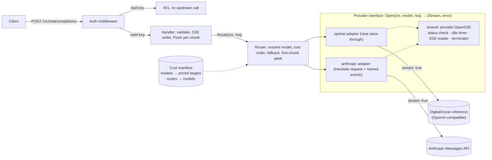
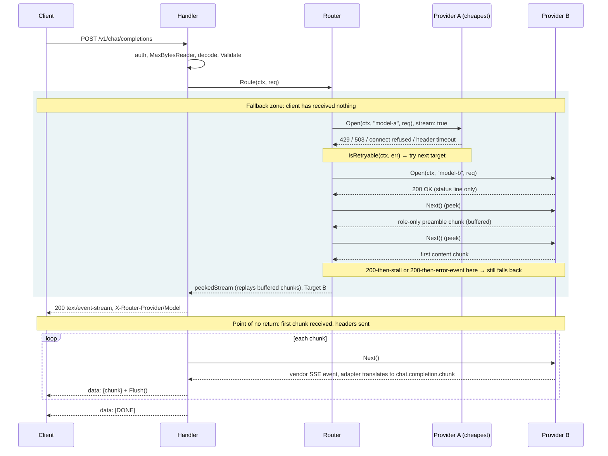
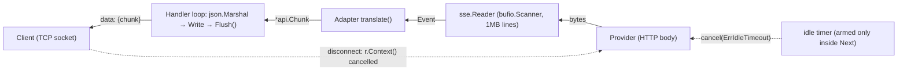

# Architecture

How a chat request moves through the gateway, how the target is chosen, where fallback is allowed,
and how chunks flow from provider to client without buffering.

## 1. Components and the adapter boundary

Everything left of the `Provider` interface uses one schema (OpenAI chat format). Vendor differences
live only in adapters, so adding a provider means adding one file that implements two functions:
`buildRequest` (unified → vendor) and `translate` (vendor SSE event → unified chunk). Status checks,
idle timeouts, terminator rules and SSE parsing are shared in `provider.OpenSSE`.

- **Handler and Router never see a vendor field name.** They only use `api.ChatRequest`, `api.Chunk`,
  `provider.Provider/Stream` and `*provider.UpstreamError`.
- **Adapters classify their own errors** (`UpstreamError.Retryable`), because vendors differ: Anthropic's
  `529 Overloaded` and in-stream `overloaded_error` are transient; a generic 4xx is not.
- **Adapters never mutate the request**: the same `*api.ChatRequest` is reused on every fallback attempt.
- In tests, an adapter's base URL points at `testutil.NewUpstream` (an `httptest.Server`), so no real API is called.

## 2. Choosing targets (cost-aware routing)

A **target** is a `(provider, upstream model, price)` triple. The manifest (`internal/config/routes.json`,
override with `ROUTES_FILE`) maps public model names to targets and route aliases to models.
Targets whose provider is not configured (e.g. no `ANTHROPIC_API_KEY`) are dropped at startup.

| Client sends `model` | Candidate targets | Ordering |
|---|---|---|
| alias, e.g. `auto`, `fast`, `smart` | every target of every model in the route | cheapest first (input + output $/1M tokens) |
| concrete model, e.g. `mistral-3-14B` | providers serving **that model only** (never silently swaps models) | cheapest first |
| omitted | `default_route` | cheapest first |
| unknown | none: `400` before any upstream call | n/a |

With a single real provider (DigitalOcean), alias fallback switches *models* within DO; same-model
cross-provider fallback (e.g. `claude-haiku` via Anthropic, then DO) activates when a second key is set.

## 3. Request lifecycle and fallback

Targets are tried in cost order until one produces its **first substantive chunk**. The client receives
nothing until then, so a failed primary is invisible to it.

`Provider.Open()` returns only after it has read the upstream status line, and the Router then peeks the
first substantive chunk. That pair is what lets the Router fall back on "accepted but broken" upstreams
(stall after 200, error event as first event, empty body) before the Handler commits to a 200. A failure
after that point is a mid-stream error (section 5).

## 4. The stream pipe

One goroutine per request pulls one chunk at a time. Data flows toward the client; cancellation and
backpressure flow toward the provider through the same call chain.

| Concern | Mechanism |
|---|---|
| Memory | One event in flight per request (plus at most 8 buffered preamble chunks during the peek), whatever the answer length. No `io.ReadAll` of a success body, no accumulating slices. |
| Client disconnect | `r.Context()` is cancelled → upstream request (created with `NewRequestWithContext` on a child ctx) is aborted → blocked `Next()` returns → `defer stream.Close()` releases the connection. Logged as `outcome=client_disconnected`; no fallback. |
| Slow client (backpressure) | `Write` blocks → `Next()` is not called → upstream TCP window fills → provider slows. The idle timer is stopped while the handler is writing, so backpressure is never mistaken for a stalled provider. |
| Concurrency | Reading and writing happen in the handler goroutine. No channels, so no buffer to grow and no goroutine to leak. The only timer goroutine is `time.AfterFunc`, stopped on every exit path. |
| Cause tracking | The stream's ctx uses `context.WithCancelCause`, so a read failure reports *why* (`ErrIdleTimeout` vs `context.Canceled`) instead of a generic "use of closed connection". |

## 5. Failure handling

| Scenario | Behaviour | Client sees |
|---|---|---|
| 408 / 429 / 502 / 503 / 504 (and Anthropic 500 / 529) | Router tries the next target in cost order | Normal stream |
| Connect refused/reset, connect/TLS/response-header timeout | Router tries the next target | Normal stream |
| 200, then stall / error event / empty body before the first chunk | Router closes it and tries the next target | Normal stream |
| Upstream 400 / 422 | No fallback: the request is wrong and retrying would hide it | `400` with upstream message |
| Upstream 401 / 403 / 404 | No fallback: gateway's provider config is wrong (key, tier, model id) | `502 upstream_config_error` (no upstream detail leaked) |
| All targets fail with retryable errors | Return before any headers are written | `502 no_available_provider`, lists provider/model/status tried |
| Connection drops mid-stream | Write one error event and stop, deliberately **without** `[DONE]` | Partial text + `{"error":{"type":"upstream_error"}}` |
| Clean EOF without `[DONE]` / `message_stop` | `ErrIncompleteStream`: treated as truncated, same as a drop | Partial text + error event |
| Idle > `IDLE_TIMEOUT` after streaming started | `ErrIdleTimeout` cancels upstream | Partial text + error event |
| Client disconnects | Context cancelled, upstream aborted, no fallback attempted | Nothing (client is gone) |
| Bad / missing gateway key | Rejected in middleware | `401`, upstream never called |

## 6. Timeouts

Layered timeouts, because a long answer is not a failure.

| Timeout | Value | Where it is set | On expiry |
|---|---|---|---|
| Connect | 5s | `net.Dialer.Timeout` | Fall back |
| TLS handshake | 5s | `Transport.TLSHandshakeTimeout` | Fall back |
| Time to response headers | 30s | `Transport.ResponseHeaderTimeout` | Fall back |
| Idle between upstream events | 30s (`IDLE_TIMEOUT`) | `time.AfterFunc` → `cancel(ErrIdleTimeout)`, armed only while `Next()` waits | Before first chunk: fall back. After: mid-stream error |
| Total request | none | Not `http.Client.Timeout`, which also covers body reads and would cut long streams | n/a |
| Server write | 0 | `http.Server.WriteTimeout` left unset for the same reason | n/a |
| Server read header | 5s | `http.Server.ReadHeaderTimeout` (slowloris protection) | Connection closed |
| Server read (body) | 30s | `http.Server.ReadTimeout` (request body only; bodies capped at 1MB) | Connection closed |
| Shutdown drain | 25s | `srv.Shutdown(ctx)` then `srv.Close()` | Remaining streams cut |

## 7. Code map

| Package | Responsibility |
|---|---|
| `cmd/server` | Wiring only: config → providers → router → handler → `http.Server`, graceful shutdown |
| `internal/api` | Unified request/chunk/error types, request validation |
| `internal/sse` | SSE reader (spec-compliant: comments, multi-line data, CRLF) and writer |
| `internal/provider` | `Provider`/`Stream` interfaces, `UpstreamError`, `IsRetryable`, `OpenSSE` plumbing, HTTP transport |
| `internal/provider/openai` | OpenAI-compatible adapter (DigitalOcean) |
| `internal/provider/anthropic` | Anthropic Messages adapter |
| `internal/router` | Manifest compilation, cost ordering, fallback loop, first-chunk peek |
| `internal/httpapi` | Auth middleware, chat handler, error mapping, mux |
| `internal/config` | Env config + embedded manifest, fail-fast validation |
| `internal/testutil` | Fake upstream used by every test layer |
