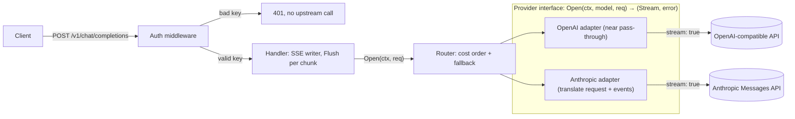
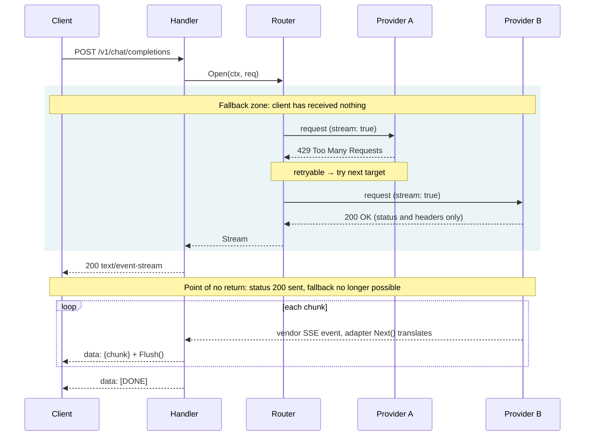
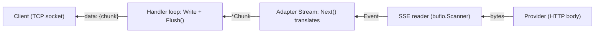

# Architecture

How a chat request moves through the gateway, where fallback is allowed, and how chunks flow from
provider to client without buffering.

## 1. Components and the adapter boundary

Everything left of the `Provider` interface uses one schema (OpenAI chat format). Vendor differences
live only in adapters, so adding a provider means adding one file.

- **Handler and Router never see a vendor field name.**
- Each adapter converts the unified request outward and converts the vendor's stream back into
  OpenAI-style `chat.completion.chunk` objects.
- In tests, an adapter's base URL points at an `httptest.Server`, so no real API is called.

## 2. Request lifecycle and fallback

Providers are tried in order until one returns 200. The client receives nothing until then, so a failed
primary is invisible to it.

`Provider.Open()` returns only after it has read the upstream status line. That is what lets the Router
decide to fall back before the Handler commits to a 200. A failure after that line is a mid-stream error
(see section 4).

## 3. The stream pipe

One goroutine per request pulls one chunk at a time. Data flows toward the client; cancellation and
backpressure flow toward the provider through the same call chain.

| Concern | Mechanism |
|---|---|
| Memory | One event in flight per request, whatever the answer length. No `io.ReadAll`, no accumulating slices. |
| Client disconnect | `r.Context()` is cancelled → upstream request (created with `NewRequestWithContext`) is aborted → `defer stream.Close()` releases the connection. |
| Slow client (backpressure) | `Write` blocks → `Next()` is not called → upstream TCP window fills → provider slows. Memory stays bounded without extra code. |
| Concurrency | Reading and writing happen in the handler goroutine. No channels, so no buffer to grow and no goroutine to leak. |

## 4. Failure handling

| Scenario | Behaviour | Client sees |
|---|---|---|
| 429 / 502 / 503 / 504, connect error, connect or header timeout | Router tries the next target in cost order | Normal stream |
| 400 / 401 / other 4xx from provider | No fallback: the request or config is wrong, and retrying would hide it | Error status |
| All targets fail | Return before any headers are written | `502` JSON error |
| Connection drops mid-stream | Write one error event and stop, deliberately **without** `[DONE]` | Partial text + error event |
| Clean EOF without `[DONE]` / `message_stop` | Adapter treats it as truncated, same as a dropped connection | Partial text + error event |
| Client disconnects | Context cancelled, upstream aborted, no fallback attempted | Nothing (client is gone) |

## 5. Timeouts

Layered timeouts, because a long answer is not a failure.

| Timeout | Value | Where it is set | On expiry |
|---|---|---|---|
| Connect and TLS | 5s | `net.Dialer.Timeout`, `Transport.TLSHandshakeTimeout` | Fall back |
| Time to response headers | 30s | `Transport.ResponseHeaderTimeout` | Fall back |
| Idle between chunks | 30s | Timer reset per chunk that cancels the request context | Mid-stream error |
| Total request | none | Not `http.Client.Timeout`, which also covers body reads and would cut long streams | n/a |
| Server write | 0 | `http.Server.WriteTimeout` left unset for the same reason | n/a |
| Server read header | 5s | `http.Server.ReadHeaderTimeout` (slowloris protection) | Connection closed |
