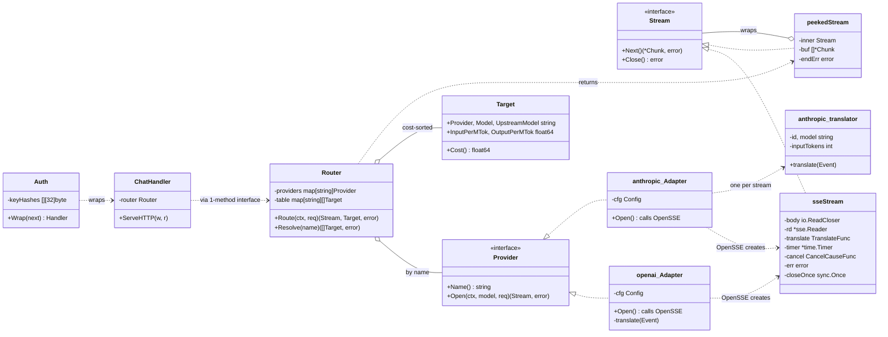
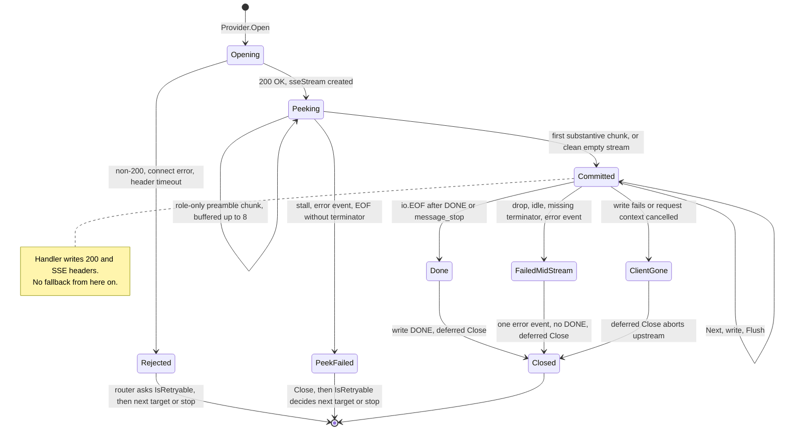
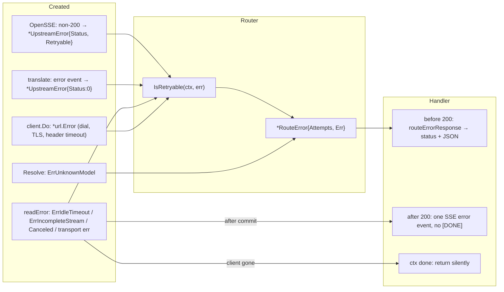

# Low-level design

[architecture.md](../architecture.md) is the high-level view: components, request flow, failure tables,
timeouts. This document is the code-level view: the types, the algorithms, the state each object
holds, and why each piece is shaped the way it is. Every section links to the code.

Contents:
1. [Types and the adapter pattern](#1-types-and-the-adapter-pattern)
2. [A request through the code](#2-a-request-through-the-code)
3. [Stream lifecycle](#3-stream-lifecycle)
4. [Algorithms](#4-algorithms)
5. [Errors: created, wrapped, classified, mapped](#5-errors-created-wrapped-classified-mapped)
6. [Concurrency and resource ownership](#6-concurrency-and-resource-ownership)
7. [Extension recipes](#7-extension-recipes)
8. [Test architecture](#8-test-architecture)
9. [Interview cheat sheet](#9-interview-cheat-sheet)

---

## 1. Types and the adapter pattern



| Type | File | Role |
|---|---|---|
| `api.ChatRequest`, `api.Chunk`, `api.ErrorResponse` | [api/types.go](../internal/api/types.go) | The unified schema (OpenAI format, text only). The only types the handler and router use for payloads. |
| `provider.Provider` | [provider.go:18](../internal/provider/provider.go#L18) | The adapter boundary. 2 methods. |
| `provider.Stream` | [provider.go:36](../internal/provider/provider.go#L36) | Pull-based chunk source. 2 methods. `io.EOF` = terminator seen; anything else = failure. |
| `provider.UpstreamError` | [provider.go:55](../internal/provider/provider.go#L55) | Typed upstream failure with `Retryable` decided by the adapter. |
| `provider.OpenSSE` + `sseStream` | [stream.go:45](../internal/provider/stream.go#L45), [stream.go:93](../internal/provider/stream.go#L93) | Shared plumbing: send, status check, idle timer, SSE parse, terminator rule. |
| `openai.Adapter` | [openai.go](../internal/provider/openai/openai.go) | `buildRequest` + `translate`. Near pass-through. |
| `anthropic.Adapter` + `translator` | [anthropic.go](../internal/provider/anthropic/anthropic.go) | `buildRequest` + stateful `translate` (needs message id / input tokens from `message_start`). |
| `router.Router`, `Target`, `Manifest` | [router.go:79](../internal/router/router.go#L79), [manifest.go](../internal/router/manifest.go) | Target resolution, cost order, fallback loop, peek. |
| `router.peekedStream` | [router.go:202](../internal/router/router.go#L202) | Replays chunks consumed during the peek, then delegates. |
| `httpapi.ChatHandler`, `Auth` | [chat.go:30](../internal/httpapi/chat.go#L30), [auth.go:14](../internal/httpapi/auth.go#L14) | HTTP surface. |

**Why the adapter is this thin.** Every rule that must hold for *all* vendors (status check before
returning, error body limit, idle timeout, "EOF without terminator is an error", cancellation cause) lives
once in `OpenSSE`. An adapter only supplies:

```go
buildRequest(model string, req *api.ChatRequest) vendorRequest        // unified -> vendor, never mutates req
translate(ev sse.Event) (chunk *api.Chunk, done bool, err error)        // vendor event -> unified chunk
RetryableStatus func(int) bool                                          // optional vendor override (Anthropic: +529, +500)
```

`translate` returns one of four outcomes, and `sseStream.Next` acts on them
([stream.go:107](../internal/provider/stream.go#L107)):

| Return | Meaning | `Next` does |
|---|---|---|
| `(chunk, false, nil)` | normal content | return chunk |
| `(nil, false, nil)` | ignorable event (ping, block start/stop, reasoning) | read the next event |
| `(nil, true, nil)` | vendor terminator (`[DONE]`, `message_stop`) | return `io.EOF` (sticky) |
| `(nil, false, err)` | vendor error event | return err (sticky) |

---

## 2. A request through the code

The happy path with one fallback, in call order. This is the "walk me through a request" answer.

| # | Where | What happens |
|---|---|---|
| 1 | [main.go](../cmd/server/main.go) | `http.Server` with `ReadHeaderTimeout` 5s, no `WriteTimeout`. Mux from `httpapi.NewMux`. |
| 2 | [auth.go:30](../internal/httpapi/auth.go#L30) | `Auth.Wrap`: parse `Bearer`, SHA-256 the token, `ConstantTimeCompare` against every configured digest (no early exit). Invalid → 401 JSON, **router never runs**. |
| 3 | [chat.go:49](../internal/httpapi/chat.go#L49) | `ServeHTTP`: request id, `MaxBytesReader` (1MB → 413), JSON decode (→ 400), `req.Validate()` (→ 400). |
| 4 | [router.go:122](../internal/router/router.go#L122) | `Route(ctx, &req)`: `Resolve(req.Model)` gives cost-sorted targets (unknown → `ErrUnknownModel` → 400). |
| 5 | [router.go:129](../internal/router/router.go#L129) | Loop over targets. First line of each iteration: `if ctx.Err() != nil` stop, the client is gone. |
| 6 | [router.go:161](../internal/router/router.go#L161) | `try(ctx, target, req)` → `provider.Open(ctx, target.UpstreamModel, req)`. |
| 7 | [openai.go:89](../internal/provider/openai/openai.go#L89) | Adapter marshals a fresh wire request (`stream: true`, `include_usage`) and calls `OpenSSE`. |
| 8 | [stream.go:52](../internal/provider/stream.go#L52) | `OpenSSE`: `ctx, cancel := context.WithCancelCause(ctx)`; `NewRequestWithContext`; `client.Do`. Transport enforces 5s connect, 5s TLS, 30s headers. |
| 9 | stream.go (after `Do`) | Non-200 → read ≤ 4KB, close body, return `*UpstreamError{Status, Retryable: opts.RetryableStatus(status), Message, RetryAfter}`. |
| 10 | [stream.go:88](../internal/provider/stream.go#L88) | 200 → build `sseStream`; create the idle timer **stopped**. Return. |
| 11 | router.go `try` | Peek: call `s.Next()` until a non-preamble chunk (≤ 8 buffered). Error → `Close`, return err. |
| 12 | router.go `Route` | Error? `IsRetryable(ctx, err)` → log attempt, next target, or stop. Success → return `peekedStream`, `Target`. |
| 13 | [chat.go:85](../internal/httpapi/chat.go#L85) | `defer stream.Close()`. Set SSE headers + `X-Router-Provider/Model`, `WriteHeader(200)` at [chat.go:95](../internal/httpapi/chat.go#L95). **Point of no return.** |
| 14 | chat.go loop | `Next()` → `json.Marshal` → `sse.WriteData` → `rc.Flush()`. Write/flush error → client gone → return (deferred `Close` aborts upstream). |
| 15 | [chat.go:116](../internal/httpapi/chat.go#L116) | `io.EOF` → `data: [DONE]`, flush. Other error → one error event at [chat.go:128](../internal/httpapi/chat.go#L128), **no `[DONE]`**. |
| 16 | chat.go deferred log | One `chat request` line: route, provider, model, outcome, chunks, duration, tokens, `est_cost_usd`. |

---

## 3. Stream lifecycle

What a single upstream stream goes through, from the router's and handler's point of view.



`sseStream` internal state per call ([stream.go:107-155](../internal/provider/stream.go#L107-L155)):

| Field | Set by | Purpose |
|---|---|---|
| `err` | `Next` only | Sticky terminal result. After `io.EOF` or a failure, every later `Next` returns the same thing without touching the body. |
| `timer` | `OpenSSE` (stopped), `Next` (`Reset` on entry to each wait, `Stop` on return via `defer`), `Close` | Idle detection, armed **only** while waiting on the upstream. |
| `cancel` | `OpenSSE` | Aborts the HTTP request. Called with `ErrIdleTimeout` by the timer, with `nil` (→ `context.Canceled`) by `Close`. |
| `cause` | `OpenSSE` (closure over ctx) | Lets `readError` report *why* the body read failed. |
| `closeOnce` | `Close` | Idempotent close: stop timer, cancel, close body. |

---

## 4. Algorithms

### 4.1 Manifest compilation (startup, once)
[manifest.go:39](../internal/router/manifest.go#L39)

```
for each model in manifest.models:
    validate targets (provider, upstream_model set; costs >= 0)
    drop targets whose provider is not configured (log them)
table[model] = sortByCost(model's targets)             // concrete model: providers of that model only
for each alias in manifest.routes:
    reject if alias == a model name, or references an unknown model
    table[alias] = sortByCost(union of its models' targets)
    reject if empty (no configured provider at all)
reject if default_route not in table
```

`sortByCost` is a **stable** sort on `input + output $/1M tokens`, so ties keep manifest order. The table
is immutable after `New`, so concurrent requests read it without locks.

### 4.2 Route: fallback loop
[router.go:122](../internal/router/router.go#L122)

```
targets = Resolve(req.Model)                          // "" -> default route; unknown -> ErrUnknownModel
for i, t in targets:
    if ctx.Err(): return RouteError{attempts, ctx.Err()}      // client gone: never start another attempt
    s, err = try(ctx, t, req)
    if err == nil: log ok(ttfb); return s, t
    attempts += {t, status, err}
    if !IsRetryable(ctx, err): return RouteError{attempts, err}   // 400/401/403, or client gone
return RouteError{attempts, ErrAllTargetsFailed}
```

### 4.3 try: open + peek
[router.go:161](../internal/router/router.go#L161)

```
s = provider.Open(ctx, t.UpstreamModel, req)          // returns after status line
loop:
    c, err = s.Next()
    if err == io.EOF: return peeked{buf, endErr: EOF} // complete (possibly empty) answer is a success
    if err != nil:    s.Close(); return err           // stall/error-event/truncation before content -> fallback-able
    buf += c
    if !isPreamble(c) or len(buf) >= 8: return peeked{buf}
```

`isPreamble(c)` ([router.go:189](../internal/router/router.go#L189)) is true only for a chunk that sets
`role` and nothing else (no content, no finish_reason, no usage). DigitalOcean sends exactly such a chunk
the moment it accepts a request, before the model produces anything. Without this rule, a stall right
after that chunk would be past the point of no return. A reasoning-only chunk (vendor field dropped, so
empty delta with no role) is *not* preamble: it proves the model is generating.

### 4.4 IsRetryable: the one classifier
[provider.go:83](../internal/provider/provider.go#L83)

Order matters:

```
1. err == nil                               -> false
2. ctx.Err() != nil or errors.Is(Canceled)  -> false   // FIRST: a cancelled request surfaces as a
                                                        // net error / unexpected EOF that would look retryable
3. errors.As(*UpstreamError)                -> ue.Retryable   // the adapter knows its vendor
4. ErrIdleTimeout, ErrIncompleteStream,
   DeadlineExceeded                         -> true
5. io.EOF, io.ErrUnexpectedEOF,
   ECONNREFUSED, ECONNRESET                 -> true    // connection died before/while responding
6. net.Error (dial/TLS/header timeouts), *net.OpError -> true
7. otherwise                                -> false   // unknown: don't hide bugs behind retries
```

Who sets `Retryable` on `UpstreamError`:

| Source | Retryable when |
|---|---|
| Non-200, default (`DefaultRetryableStatus`) | 408, 429, 502, 503, 504 |
| Non-200, Anthropic (`retryableStatus`) | the above + 500, 529 |
| In-stream error, OpenAI-compatible (`retryableErrorType`) | type contains rate_limit / overloaded / server_error / timeout / unavailable |
| In-stream error, Anthropic | `overloaded_error`, `api_error`, `rate_limit_error`, `timeout_error` |

### 4.5 Idle timer
[stream.go:88-89](../internal/provider/stream.go#L88-L89), [stream.go:111-113](../internal/provider/stream.go#L111-L113)

```
OpenSSE:  timer = AfterFunc(idle, cancel(ErrIdleTimeout)); timer.Stop()   // created disarmed
Next:     defer timer.Stop()
          loop: timer.Reset(idle); ev = read()                            // armed only during the read
                ...skip ignorable events (loop re-arms)...
```

Why not "reset per chunk" with the timer always running: the handler blocks in `Write` when the client
is slow. A timer running during that time would fire and kill a healthy stream. Measuring only the time
spent *waiting on the upstream* separates "provider stalled" from "client applying backpressure"
(`TestSlowConsumerIsNotIdle`).

When the timer fires: `cancel(ErrIdleTimeout)` aborts the HTTP request → the blocked body read returns an
error → `readError` sees `context.Cause(ctx) == ErrIdleTimeout` and returns that instead of the
transport's "use of closed network connection".

### 4.6 SSE parsing
[sse.go:36](../internal/sse/sse.go#L36)

Line-oriented per the SSE spec: `bufio.Scanner` (64KB initial, 1MB max line), `data:` lines joined with
`\n`, `event:` sets the name, `:` lines are comments/keep-alives, blank line dispatches, `id`/`retry`
ignored, CRLF handled. A final event without a trailing blank line is still dispatched at EOF: a
truncated payload then fails JSON decoding or terminator matching, so being lenient here never turns a
broken stream into a success. `Scanner.Err()` (including line too long) is returned wrapped: an aborted stream.

### 4.7 Auth comparison
[auth.go:42](../internal/httpapi/auth.go#L42)

Keys are stored as SHA-256 digests. The presented token is hashed and compared with
`subtle.ConstantTimeCompare` against **every** digest, OR-ing results. Hashing makes the comparison
length-independent (raw `ConstantTimeCompare` returns early on length mismatch); not breaking early hides
which key matched.

---

## 5. Errors: created, wrapped, classified, mapped



`RouteError.Unwrap()` returns `Err`, so the handler uses `errors.Is` / `errors.As` straight through it.
Mapping ([chat.go:151](../internal/httpapi/chat.go#L151)):

| `errors.Is/As` on the route error | HTTP | `type` |
|---|---|---|
| `ErrUnknownModel` | 400 | `invalid_request_error` |
| `ErrAllTargetsFailed` | 502 | `no_available_provider` (message lists provider/model/status tried) |
| `*UpstreamError` 400 / 413 / 422 | 400 | `invalid_request_error` (upstream message passed through) |
| `*UpstreamError` 401 / 403 / 404 | 502 | `upstream_config_error` (no upstream detail leaked) |
| anything else | 502 | `upstream_error` |
| `ctx.Err() != nil` (checked first) | none | client is gone; log only |

Rules followed: errors are wrapped with `%w` and context (`"digitalocean: reading stream: ..."`), never
both logged and returned at the same layer (router logs attempts and returns a *summary* type; handler
logs the request outcome), and no `panic` outside `main` (the fake upstream's `panic(http.ErrAbortHandler)`
is test-only and is net/http's documented way to abort a response).

---

## 6. Concurrency and resource ownership

**Goroutines per request:** the net/http handler goroutine does all reading and writing. Others that exist:

| Goroutine | Lifetime | Exit path |
|---|---|---|
| net/http transport read/write loops (per upstream connection) | owned by `http.Transport` | connection close / idle timeout |
| `time.AfterFunc` callback | runs only if the idle timer fires; executes `cancel(...)` and exits | immediate |
| `main`'s `ListenAndServe` goroutine | process lifetime | `srv.Shutdown` / `srv.Close` |

There are no channels in the request path, so there is no buffer that can grow and no goroutine that can
block forever.

**Shared state and why it is race-free (`go test -race` in CI):**

| State | Shared by | Safety |
|---|---|---|
| `Router.table`, `Router.providers` | all requests | written once in `New`, read-only afterwards |
| `Auth.keyHashes` | all requests | read-only after `NewAuth` |
| `http.Client` / `Transport` | all adapters | safe for concurrent use by design |
| `sseStream` fields | its handler goroutine + timer callback | callback only calls `cancel` (goroutine-safe); `Close` guarded by `sync.Once` |
| `anthropic.translator` | one stream | created per `Open`, never shared |

**Who closes what:**

| Resource | Owner | Closed by |
|---|---|---|
| Upstream response body (non-200) | `OpenSSE` | `defer resp.Body.Close()` before returning the error |
| Upstream response body (200) | `sseStream` | `Close()` |
| Stream that failed during peek | `Router.try` | `s.Close()` before trying the next target |
| Stream returned by `Route` | handler | `defer stream.Close()` (covers EOF, mid-stream error, client gone, panic) |
| Child context of each upstream request | `sseStream` | `cancel` in `Close` (or on every `OpenSSE` error path) |

---

## 7. Extension recipes

**Add an OpenAI-compatible provider** (Together, Groq, vLLM, OpenAI itself): no new code.
1. In `main.go`, add `openai.New(openai.Config{Name: "together", BaseURL: ..., APIKey: cfg.X, ...})` and an env var (update `.env.example`).
2. Add targets with `"provider": "together"` to the manifest.

**Add a provider with its own wire format** (e.g. Gemini): one package.
1. `internal/provider/gemini/gemini.go`: `Config`, `New`, `Name`, `buildRequest`, `translate` (+ a per-stream struct if it needs state), and `RetryableStatus` if its codes differ.
2. `Open` = marshal + `provider.OpenSSE(ctx, opts, buildHTTPRequest)`.
3. Add a `FormatGemini` to `testutil` and copy the anthropic test file's structure: translation, request not mutated, status classification, error event, missing terminator.

**Add a route or change prices:** edit [routes.json](../internal/config/routes.json) or point `ROUTES_FILE` at
a file. `TestEmbeddedManifestCompiles` catches mistakes in the embedded one; unknown fields are rejected.

**Tool calling / multimodal (out of scope today):** `Provider.Open` takes the whole `*api.ChatRequest`, so
this is additive: add `Tools`, content parts and `ToolCalls` deltas to `api` types, then teach each
adapter's `buildRequest`/`translate`. Router and handler do not change.

---

## 8. Test architecture

One fake, used at every layer: [testutil/upstream.go](../internal/testutil/upstream.go).

| Mode | Behaviour | Used to prove |
|---|---|---|
| `ok` | role chunk, content chunks, finish, usage, terminator | translation, happy path |
| `400` / `401` | JSON error | no fallback, error mapping |
| `429` (Retry-After: 7) / `503` / `529` | JSON error | fallback, `RetryAfter`, vendor classification |
| `slow` | never sends headers | response-header timeout → fallback |
| `stall` | 200 + headers, then silence | idle timeout → fallback before commit |
| `error-first` | 200, then a vendor error event | in-stream error → fallback before commit |
| `midfail` | first chunk, then aborts the connection | mid-stream error event, no `[DONE]` |
| `nodone` | everything except the terminator | `ErrIncompleteStream` |
| `hang` | first chunk, then waits for cancel | client disconnect propagates upstream |

Each fake records `Calls()`, `LastBody()`, `LastAuth()`/`LastAPIKey()`, and closes `Cancelled()` when it
observes the request context ending. That is what lets tests assert *behaviour* ("the backup was never
called", "the upstream saw the cancel") rather than just `err == nil`.

Layering: `sse`, `api`, `provider` are unit tests; adapter tests run real HTTP against the fake; router
tests run real adapters against fakes; `httpapi` tests run the **full stack** (auth → handler → router →
adapter → fake) through a real `httptest.Server` and a real HTTP client.

---

## 9. Interview cheat sheet

Short answers to the questions this design invites:

- **Where exactly does fallback stop being possible?** When the handler writes the 200. That happens only after the router has seen the first *substantive* chunk, so "200 then stall" and "200 then error event" still fall back.
- **Why not fall back mid-stream?** The client already has part of answer A; continuing with model B splices two different answers together. The client gets an explicit error event and no `[DONE]`, so it knows the answer is truncated.
- **How does a client disconnect stop the upstream?** `r.Context()` is the parent of the upstream request's context, so cancelling it aborts the HTTP request, unblocks `Next`, and the deferred `Close` releases the connection. The router checks `ctx.Err()` before every attempt and before classifying an error, so a gone client never triggers fallback.
- **Why is the idle timer not just "reset per chunk"?** Because it would also count time the handler spends blocked on a slow client. It runs only while waiting on the upstream.
- **Why does the adapter decide retryability?** Vendors disagree (Anthropic's 529, error event types). The router keeps one classifier that asks the typed error.
- **Why is the request never mutated?** It is reused across fallback attempts; a mutation by adapter A (e.g. moving the system prompt) would corrupt the request sent to B. Tests compare the request before and after.
- **Memory per request?** One event plus at most 8 preamble chunks. No `ReadAll` of a success body. Backpressure flows to the upstream through TCP.
- **Why no `http.Client.Timeout` / `WriteTimeout`?** Both cover the whole body and would cut off long generations. Connect, TLS, header, and idle timeouts cover the real failure modes.
- **What breaks with one real provider?** Live fallback switches models within DigitalOcean, which does not help during a DO-wide outage. A second key adds real provider redundancy with no code change.
